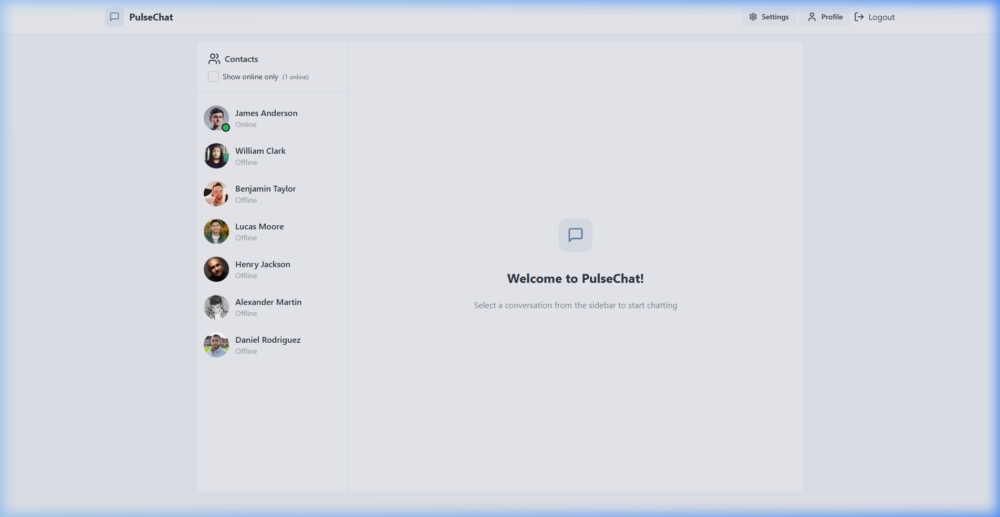
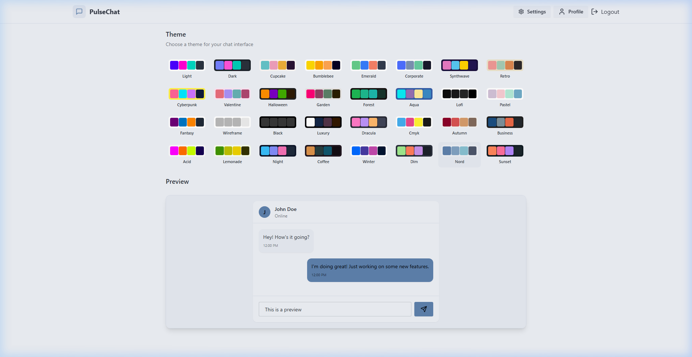
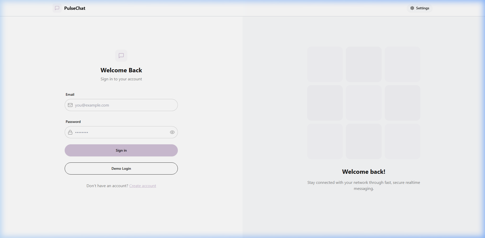
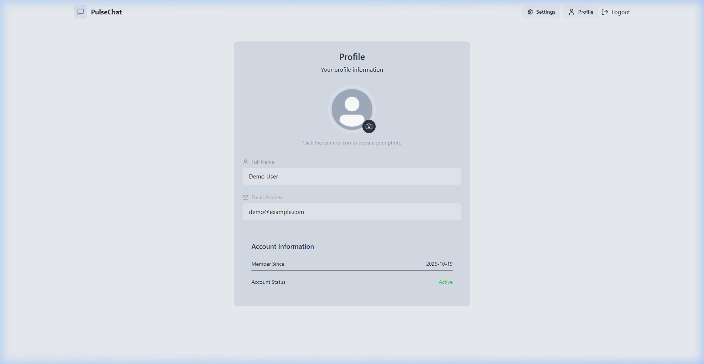

# PulseChat — Realtime Web Messaging Application

**Live Demo**: [https://pulsechat-qm69.onrender.com](https://pulsechat-qm69.onrender.com)

A full-stack, realtime communication platform built with the MERN stack (MongoDB, Express, React, Node.js) and Socket.io. The application supports bidirectional messaging, live user presence, typing status indicators, cloud media storage via Cloudinary, and dynamic UI theming.

---

## Overview

PulseChat is designed as an end-to-end messaging solution demonstrating production web development patterns:
- Stateful WebSocket connections paired with RESTful HTTP endpoints.
- Cookie-based JSON Web Token (JWT) authentication for secure session management.
- Reactive client state management using Zustand.
- Resilient cloud image processing for avatar and chat attachments.
- Component-driven UI built on Tailwind CSS and DaisyUI.

---

## System Architecture

```
+-------------------------------------------------------------------+
|                           Client (React)                          |
|   - Zustand Stores (Auth, Chat, Theme)                            |
|   - Socket.io Client (Realtime duplex stream)                     |
|   - Axios HTTP Client (REST API)                                  |
+---------------------------------+---------------------------------+
                                  |
               +------------------+------------------+
               | HTTP Requests                       | WebSocket Events
               v                                     v
+---------------------------------+   +-----------------------------+
|        Express REST API         |   |      Socket.io Server       |
|   - Authentication routes       |   |   - Connection mapping      |
|   - Message routes              |   |   - Online presence broadcast|
|   - JWT verification middleware |   |   - Typing status relay     |
+----------------+----------------+   +--------------+--------------+
                 |                                   |
                 +-----------------+-----------------+
                                   |
                                   v
+-------------------------------------------------------------------+
|                          Data & Storage                           |
|   - MongoDB Atlas: Document storage for Users and Messages        |
|   - Cloudinary: Media CDN for profile images and attachments      |
+-------------------------------------------------------------------+
```

---

## Screenshots

| Chat Interface | Theme Switcher |
|:---:|:---:|
|  |  |

| Authentication & Demo Login | User Profile |
|:---:|:---:|
|  |  |

---

## Core Features

- **Realtime Bidirectional Messaging**: Messages are delivered instantly between online clients over WebSockets without polling.
- **Online Presence Tracking**: The server tracks connected sockets by user ID and broadcasts real-time status updates to contact lists.
- **Typing Indicators**: Active typing events are relayed to chat recipients with a 2-second debounce timer to prevent network flooding.
- **Cloud Media Pipeline**: Images are ingested via client-side Base64 conversion and uploaded to Cloudinary, with secure URLs persisted in MongoDB.
- **Theme Customization**: 32 accessible DaisyUI themes with instant runtime switching, scoped preview cards, and browser persistence via `localStorage`.
- **Preconfigured Demo Access**: A single-click demo login (demo@example.com / password123) enables instant access on both local and live deployments without manual registration.
- **Security & Authorization**: Passwords are protected using bcrypt salt rounds; JWT credentials are transmitted exclusively through HTTP-only cookies with SameSite policy protection.

---

## Tech Stack

| Layer | Technologies |
|:---|:---|
| **Frontend** | React 18, Vite, Tailwind CSS, DaisyUI, Zustand, Lucide React, Axios |
| **Backend** | Node.js, Express.js, Socket.io |
| **Database** | MongoDB Atlas, Mongoose ODM |
| **Cloud Storage** | Cloudinary API |
| **Authentication** | JSON Web Tokens (JWT), bcryptjs, cookie-parser |

---

## Getting Started

### Prerequisites
- Node.js (v18.0.0 or higher)
- npm or yarn
- MongoDB Atlas cluster
- Cloudinary account

### Installation

1. Clone the repository:
   ```bash
   git clone https://github.com/hassansim/pulsechat.git
   cd pulsechat
   ```

2. Install dependencies for root, backend, and frontend:
   ```bash
   npm install
   npm install --prefix backend
   npm install --prefix frontend
   ```

3. Configure environment variables in `backend/.env`:
   ```env
   PORT=5001
   NODE_ENV=development
   MONGODB_URI=your_mongodb_connection_string
   JWT_SECRET=your_jwt_secret_key

   CLOUDINARY_CLOUD_NAME=your_cloudinary_cloud_name
   CLOUDINARY_API_KEY=your_cloudinary_api_key
   CLOUDINARY_API_SECRET=your_cloudinary_api_secret
   ```

4. (Optional) Seed initial contacts:
   ```bash
   node backend/src/seeds/user.seed.js
   ```

5. Start the development server:
   ```bash
   npm run dev
   ```

   The frontend will be accessible at `http://localhost:5173` and the backend API at `http://localhost:5001`.

---

## API Reference

### Authentication Endpoints (`/api/auth`)
- `POST /api/auth/signup` - Register a new user account.
- `POST /api/auth/login` - Authenticate credentials and issue JWT cookie.
- `POST /api/auth/logout` - Invalidate session and clear auth cookie.
- `PUT /api/auth/update-profile` - Upload profile image and update record.
- `GET /api/auth/check` - Validate session on application load.

### Messaging Endpoints (`/api/messages`)
- `GET /api/messages/users` - Retrieve contact list excluding active user.
- `GET /api/messages/:id` - Fetch chat history with specific contact.
- `POST /api/messages/send/:id` - Dispatch new message (text and/or image attachment).

### WebSocket Event Protocol
- `connection`: Client connects passing `userId` via handshake query.
- `getOnlineUsers`: Server emits array of active user IDs to all clients.
- `newMessage`: Server delivers incoming message payload to recipient socket.
- `typing`: Client signals active typing to a target user.
- `stopTyping`: Client signals cessation of typing.
- `userTyping`: Server forwards typing event to recipient.
- `userStoppedTyping`: Server forwards stop event to recipient.

---

## Production Build

To build the client application and serve it from the Express server:

```bash
# Build frontend bundle
npm run build

# Start production server
npm start
```

---

## License

This project is licensed under the MIT License. See [LICENSE](LICENSE) for details.
